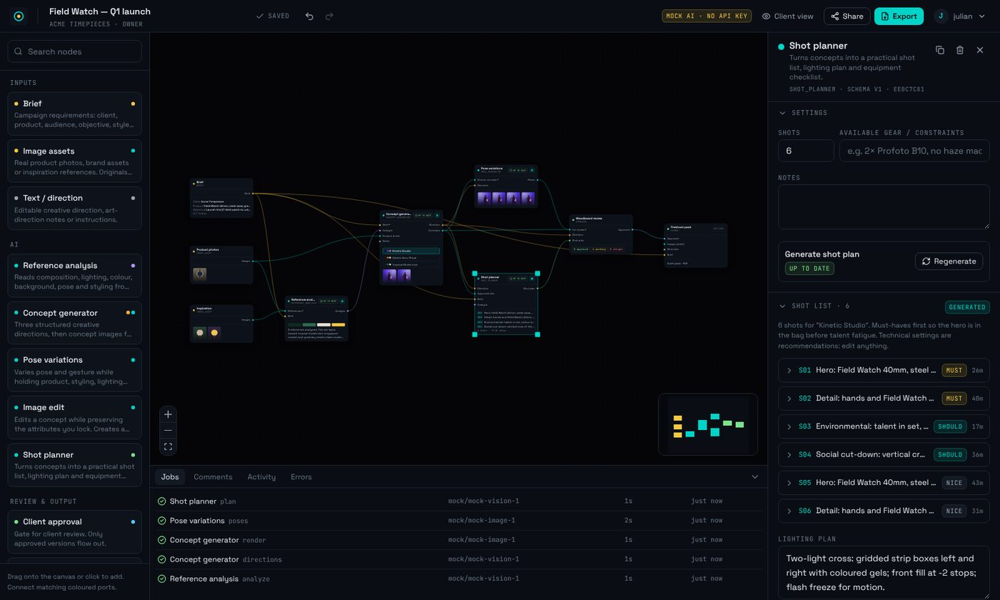
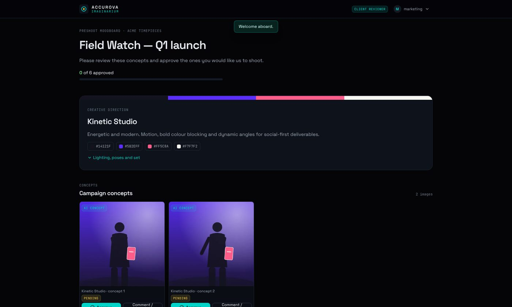
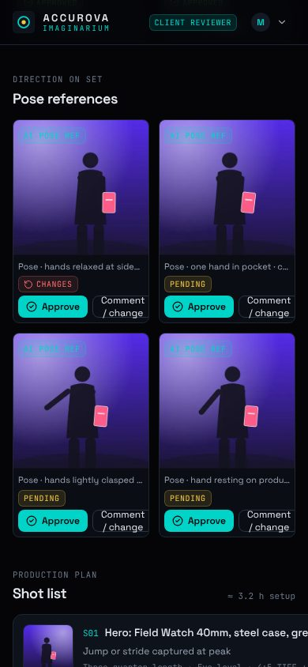
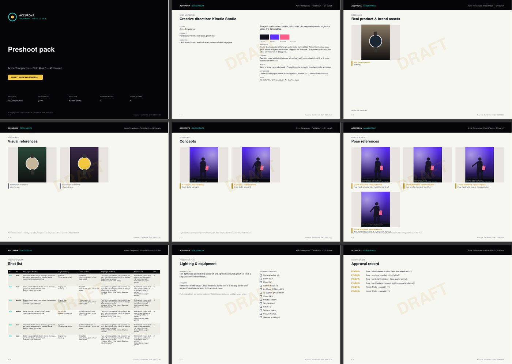

# Accurova Imaginarium

AI-assisted preshoot planning for **Accurova**. Turn a client brief into three creative directions, concept images, pose variations and a practical shot list, then get client sign-off and export an Accurova-branded PDF pack.



| Client review (desktop) | Client review (phone) | PDF pack |
|---|---|---|
|  |  |  |

## The workflow

1. **Create a campaign project.** The Accurova template comes pre-wired: brief → product photos + inspiration → reference analysis → concept generator → pose variations → shot planner → client approval → export.
2. **Fill in the brief:** client, product, audience, objective, style, deliverables, constraints.
3. **Upload** real product photos, brand assets and inspiration. Originals are kept byte-for-byte and are never edited.
4. **Analyse references:** composition, lighting, palette, background, pose and styling.
5. **Generate three distinct directions**, each with a palette, lighting setup, shots, poses, set and props, and things to avoid.
6. **Pick one and render concepts**, then **vary poses** (choose what may change and what must stay fixed) or **edit** a concept. Edits create a new version.
7. **Plan the shoot:** shot IDs, priorities, pose direction, angle, framing, lens, camera position, lighting and modifiers, set, product placement, equipment, setup time and deliverable format. Every field can be edited.
8. **Invite the client** as a reviewer. They get a simple, mobile-friendly moodboard and never see the node editor.
9. **The client approves or requests changes** per image and comments. Approvals are tied to the exact version, so an edited image needs a fresh approval and the old decision stays on record.
10. **Export the PDF pack.** A draft includes everything, marked DRAFT. The final pack includes only approved work.

Nothing runs until you press **Run**. Moving or resizing nodes never triggers AI. When an upstream input changes, the affected nodes show **stale** and keep their outputs until you regenerate. Regenerating never silently replaces an approved image.

## Quick start

Needs Node 20.11+.

```bash
npm install

# A. Browser-only demo: no server, nothing to configure. Mock AI, data stays in this browser.
npm run dev                 # http://localhost:5173

# B. Full stack locally: API, job worker, embedded Postgres (PGlite), local files, dev login, mock AI
npm run dev:full            # http://localhost:5173 (API on :8787)
```

In option B, sign in with any email (dev login). To see the client view, invite an email from **Share**, open the link in a private window and sign in as that address.

## Architecture

```
Browser (React + Vite + React Flow + Tailwind)
  │  ApiRepository: REST + bearer token; polls a per-project change token every 2 s
  ▼
API (Hono on Node, server/)          ← one codebase for a VPS/Render/Railway or a Vercel Function
  ├─ Auth: Supabase Auth JWTs (prod) or email-only dev login (local)
  ├─ Backend: Zod validation → permission check → SQL as the `authenticated` role (RLS applies)
  ├─ Job engine (src/core/jobEngine.ts) + Postgres queue (server/jobs/pgJobStore.ts)
  │     claim (FOR UPDATE SKIP LOCKED) → run → store files → insert run → mark succeeded
  ├─ AI provider adapter: mock or OpenAI (keys are server-side only)
  ├─ PDF export (jsPDF + sharp), run as a job
  └─ Storage: Supabase Storage (private bucket, signed URLs) or local disk (HMAC-signed URLs)
Postgres: Supabase in production; PGlite or plain Postgres locally (same migrations, same RLS)
```

Key decisions:

- **One domain core, two backends.** `src/core` (node registry, graph rules, hashing, staleness, job engine, executors, prompts) runs in the browser for the offline demo and on the server for real use, so both modes behave the same.
- **Postgres as the durable queue.** Jobs are rows. Workers claim them atomically, renew a lease with heartbeats and can be cancelled from any process. If a worker dies, its job is picked up again once the lease expires. A partial unique index allows at most one live job per node operation, and idempotency keys dedupe retried requests. This is the "suitable durable job queue" option from the brief; no extra infrastructure needed.
- **RLS as a second line of defence.** The API checks the role matrix explicitly, then runs every user query as Supabase's `authenticated` role with that user's claims. The policies would hold even for a client calling Supabase directly. Only the worker uses the owner connection.
- **Staleness by input hash.** Each run stores the hash of its input snapshot (config plus resolved upstream outputs plus prompt version). A node is stale when its current hash differs. Positions, selections and shot-plan edits are excluded from the hash.
- **Polling, not Realtime.** A cheap change token per project keeps the client simple and works on every host. Supabase Realtime can be added later without changing the data model.

More detail: [docs/architecture.md](docs/architecture.md).

## Configuration

Everything is in [.env.example](.env.example) with comments. Copy it to `.env`. The essentials:

| Variable | Local default | Production |
|---|---|---|
| `DATABASE_URL` | empty → PGlite in `DATA_DIR` | Supabase connection string |
| `AUTH_MODE` | `dev` | `supabase` + `SUPABASE_URL`, `SUPABASE_ANON_KEY` |
| `STORAGE` | `local` | `supabase` + `SUPABASE_SERVICE_ROLE_KEY` |
| `AI_PROVIDER` | `mock` | `openai` + `OPENAI_API_KEY` |
| `VITE_BACKEND` | — | `server` (build-time) |
| `CRON_SECRET` | — | needed on Vercel |

Secrets (`SUPABASE_SERVICE_ROLE_KEY`, `OPENAI_API_KEY`, `SIGNING_SECRET`, `CRON_SECRET`) are read only by the server. Nothing prefixed `VITE_` is secret.

## Supabase setup

1. Create a project (Singapore region `ap-southeast-1` keeps data close to clients).
2. Apply the migrations, one way only:
   - `supabase link --project-ref <ref> && supabase db push`, **or**
   - `DATABASE_URL=<connection string> npm run db:migrate`
3. Storage: the migration creates the private `project-assets` bucket and its policies.
4. Auth → URL configuration: add your site URL so confirmation and reset emails link back correctly.
5. Set the server env: `AUTH_MODE=supabase`, `SUPABASE_URL`, `SUPABASE_ANON_KEY`, `SUPABASE_SERVICE_ROLE_KEY`, `STORAGE=supabase`, `DATABASE_URL`.

Migrations live in `supabase/migrations/`:

- `…0100_core_schema.sql`: tables, composite foreign keys, triggers
- `…0200_rls.sql`: policies, `accept_invitation()`, `preview_invitation()`
- `…0300_storage.sql`: bucket and storage policies (Supabase only)

## AI configuration

```env
AI_PROVIDER=openai
OPENAI_API_KEY=sk-...
OPENAI_TEXT_MODEL=gpt-4.1        # any vision model with JSON-schema structured outputs
OPENAI_IMAGE_MODEL=gpt-image-2   # or a newer gpt-image-2.x, or gpt-image-1/1.5
```

- **Reasoning** (analysis, directions, shot plans) uses the Responses API. Images are downscaled to 1536 px, and output uses strict JSON schemas. Every reply is validated again with Zod; malformed output is retried.
- **Concepts** with product or reference photos go through `/images/edits`, with the real photos as inputs so the actual product conditions the result. Without photos they use `/images/generations`. Pose variations and edits transform the chosen source image.
- **Errors**: rate limits, 5xx and timeouts retry with backoff; auth, quota, content-policy and refusal errors fail immediately with a clear message.
- **Costs**: `MAX_JOBS_PER_USER_PER_DAY` and `MAX_CONCURRENT_JOBS_PER_PROJECT` cap spend. Set `OPENAI_PRICE_*` to show an estimated cost per job.

The mock provider is deterministic, costs nothing and draws clearly labelled placeholders ("MOCK AI CONCEPT"). Tests and the demo use it.

## Deployment

### Option A: one Node server (VPS, Render, Railway, Fly.io)

```bash
VITE_BACKEND=server npm run build && npm run build:server
NODE_ENV=production npm start     # serves dist/ + API + worker on $PORT
```

Put it behind a reverse proxy with HTTPS (Caddy or nginx). Use `pm2` or a `systemd` unit to keep it running. With `STORAGE=local`, back up `DATA_DIR`. With Supabase, the server is stateless. You can run several instances: they share the queue safely.

### Option C: Cloudflare Workers (browser-only demo)

This is what runs at https://imaginarium.accurova.com. `wrangler.jsonc` serves the built `dist/` as static assets (mock AI, data in the visitor's browser, clearly labelled as a demo). Server mode is not part of this deployment.

```bash
npm ci && npm run build && npx wrangler deploy
```

Status, pending tasks and deploy notes: [progress.md](progress.md).

### Option B: Vercel (frontend + API function) + Supabase

`vercel.json` builds the static app into `dist/` and the API into `api/index.mjs` (rewrites send `/api/*` there). Set the env vars in Vercel (including `VITE_BACKEND=server` and `CRON_SECRET`), and use Supabase's **transaction pooler** URL (port 6543).

- Jobs started by a request run to completion inside that invocation (`waitUntil`, up to 300 s).
- Vercel Cron calls `/api/worker/tick` to pick up retries and leftovers. Every 10 minutes needs the Pro plan; Hobby allows one cron run per day.

### Migrating off Zeabur

This app was never on Zeabur. Option A suits a VPS such as SGserver01. Option B suits a fully managed setup. Both use the same build; only env vars differ.

## Security model

| | Owner | Editor | Client reviewer | Viewer |
|---|:-:|:-:|:-:|:-:|
| View moodboard and assets | ✓ | ✓ | ✓ | ✓ |
| Comment | ✓ | ✓ | ✓ | |
| Approve / request changes | ✓ | ✓ | ✓ | |
| Edit graph, upload, run AI, export | ✓ | ✓ | | |
| See jobs and errors | ✓ | ✓ | | |
| Invite / manage members, delete project | ✓ | | | |

- Non-members get **404**, so a project's existence isn't revealed. Every ID from the client is resolved under RLS.
- Composite foreign keys mean a node, edge, comment or approval can't reference another project's rows.
- Uploads go straight to storage through a short-lived signed URL. The server then decodes the file and accepts only real JPEG, PNG or WebP (SVG and HTML are rejected whatever they're named), enforces size and count limits, stores it under the verified type and makes a thumbnail.
- All files are private. The app hands out signed URLs that expire after an hour.
- Approvals are append-only. A "changes requested" decision must include a comment.
- Invitations are 256-bit tokens, expire after 30 days, and only the invited email address can accept them.

Image consent, commercial rights and third-party AI processing: see [docs/ai-and-image-rights.md](docs/ai-and-image-rights.md).

## Testing

```bash
npm test          # unit + server suites (starts a throwaway Postgres if one is installed; or set TEST_DATABASE_URL)
npm run test:e2e  # Playwright: full journey in the browser demo and in server mode
npm run check     # typecheck + lint + tests
```

| Suite | Covers |
|---|---|
| `tests/core` | node schemas, valid/invalid connections, cycle detection, staleness, approval versioning, job engine (local), PDF text safety |
| `tests/server/rls.test.ts` | RLS directly in Postgres: isolation across clients, per-role writes, append-only approvals, invitation rules, cross-project foreign keys |
| `tests/server/api.test.ts` | role matrix over HTTP, 404 for outsiders, uploads (fake images, size, tampered tokens), signed URLs, graph conflicts (409) and validation |
| `tests/server/jobs.test.ts` | idempotency, burst dedupe, retries and backoff, permanent failures, cancellation, daily limits, storage failure, lease recovery, two workers sharing one queue, approved work never replaced |
| `tests/server/e2e.test.ts` | brief → analysis → directions → concepts → poses → shot plan → invite → approvals → edit v2 → final PDF, entirely through the API |
| `tests/server/openai.test.ts` | OpenAI request shapes, strict schemas, image sizes per model, error mapping, cancellation (mocked HTTP) |
| `tests/server/pglite.test.ts` | the zero-install path |
| `tests/e2e/*.spec.ts` | the whole journey in a real browser, in both modes |

CI (`.github/workflows/ci.yml`) runs all of it against a Postgres 16 service.

## Project structure

```
src/core/          domain: types, node registry + schemas, graph rules, hashing, job engine, executors, prompts
src/ai/            mock provider
src/data/          Repository interface; local (IndexedDB) and API implementations; templates
src/features/      editor (canvas, inspectors, activity), review, share, export (PDF), auth, projects
server/            config, db (postgres.js / PGlite, migrations, mappers), auth, storage, images (sharp),
                   ai (OpenAI), jobs (Postgres queue), backend (services), app (routes), runtime, entries
supabase/          migrations + local auth shim
tests/             core, server and Playwright e2e suites
```

## Known limitations and next steps

- **Not yet run against live services.** The OpenAI adapter is tested with mocked HTTP, and the Supabase Auth and Storage adapters follow the documented APIs. The SQL is verified on Postgres 16 and PGlite. Before the first real campaign: set real keys, run one project end to end, and check outputs and costs.
- **PDF fonts are Latin-only.** Chinese text in a brief shows as "?" in the PDF (it displays fine in the app). Next step: embed a subset of Noto Sans SC.
- **Invitations are copy-and-send links.** No email is sent yet. Supabase Auth invite emails or Resend would slot in here.
- **Live updates poll every 2 s.** Supabase Realtime would make this push-based.
- **The editor is desktop-first.** The client review is mobile-first.
- **Pilot:** run a real Accurova campaign through the app, then tune prompts (`src/core/prompts.ts`; bump `promptVersion` when you change one) and default shot-plan settings.
